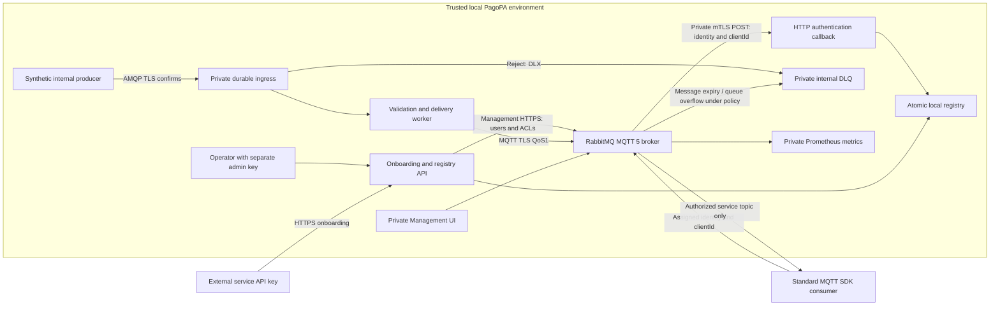
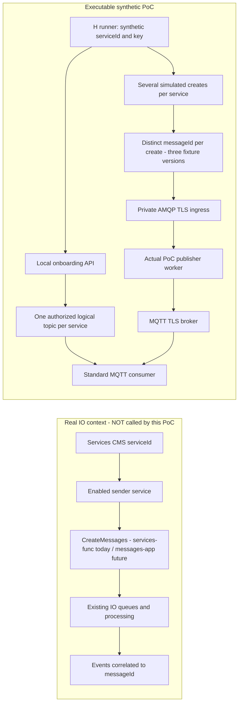
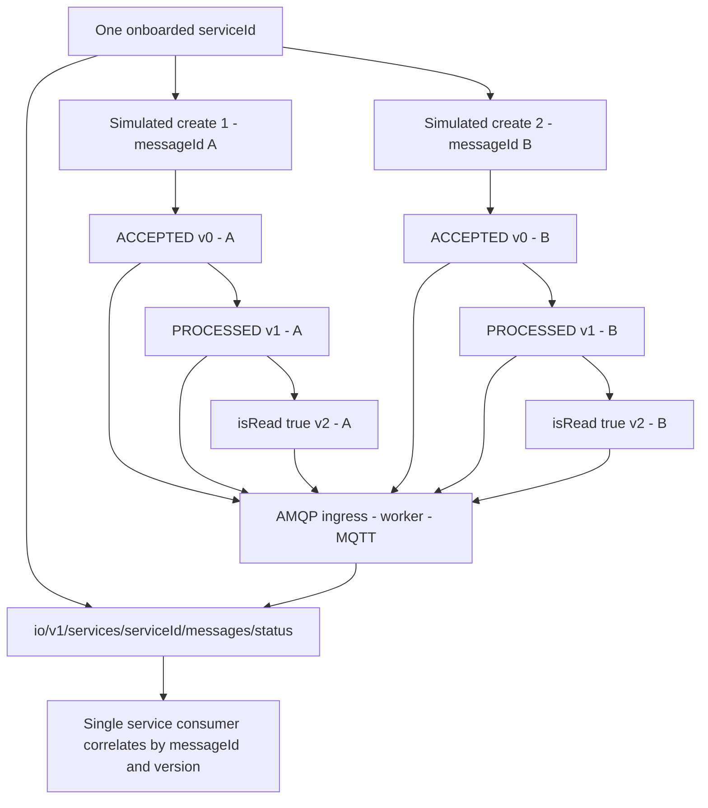
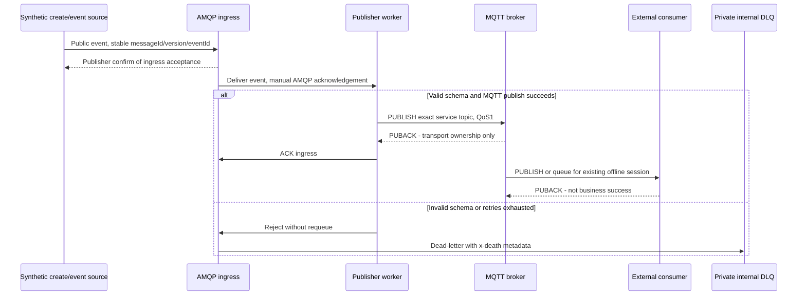
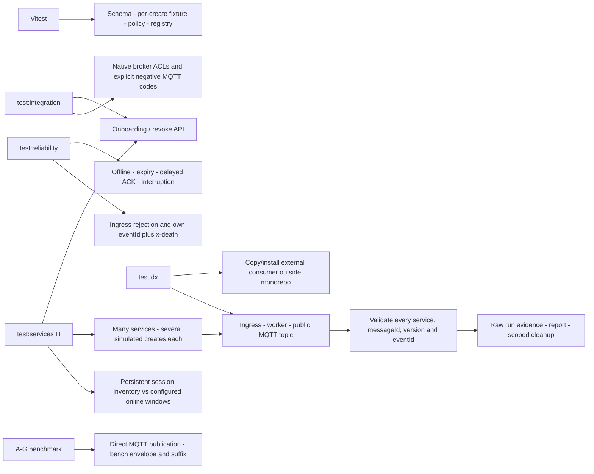

# MQTT PoC Architecture

## Scope and Approved Decisions

The authorization boundary is an IO **serviceId**, not the organization owning multiple services. Synthetic A and B can represent services of the same organization; they still have different keys, topics, identities and sessions. No delegation or cross-service access is supported.

In real IO, this service is registered/enabled in Services CMS and sends CreateMessages requests. Production currently uses `services-func`; `messages-app` does not yet carry production traffic. The existing IO queue flow produces subsequent events for each message. The PoC must model **one service -> many creates/messages -> a sequence per message -> the same service topic**, but never invoke either CreateMessages implementation, Services CMS or actual IO queues/change feeds.

All delivery statuses and `isRead` changes are eligible. `isArchived`, citizen identifiers, subjects, content, payment fields and free-text rejection details are excluded. The strict versioned public schema is [mqtt-poc-event.schema.json](mqtt-poc-event.schema.json). The PoC publishes only synthetic events. Production change feeds remain authoritative and untouched.

MQTT 5, verified TLS, QoS1, JSON, no ordering requirement, no historical replay, no events before first subscription, no business ACK and no broker-failure tests were agreed. Retention and backlog limits are configurable calibration parameters. External business errors belong to the consumer, not PagoPA's DLQ.

## Components and Boundaries



Management UI, queue/exchange names, topology, permissions and callback APIs are operator-only. The external integration contract consists of an HTTPS onboarding exchange and MQTT endpoint, credential bundle, assigned clientId, authorized topic, CA and public event schema. No RabbitMQ SDK or administrative API is required by consumers.

The local Compose profile contains four services: RabbitMQ, onboarding/auth, internal publisher/worker and standard Prometheus. Existing repository services and Event Hubs ports are unchanged. All host ports bind only to loopback. Broker authentication callbacks require the broker's specific certificate fingerprint, not merely any certificate signed by the development CA. The broker bootstraps only its own leaf key, public CA and definitions into rabbitmq-owned files; the CA private key is not copied. The publisher mounts only its own credential and public CA, not operator/admin secrets.

## Onboarding, Activation and Revocation

1. An operator enables a synthetic `serviceId` and key using the separately protected admin API. Real deployment would delegate raw key validation and service identity resolution to an approved APIM/IAM boundary.
2. `POST /subscriptions` derives service identity from the key; the strict request body permits only `appId`. Forged service identifiers are rejected.
3. The registry creates a globally unique username/clientId pair in `pending`, retaining the same pair and credentials on retry.
4. Provisioning creates the internal user, exact service topic permissions and exact session resource permissions, then reads them back. HTTP authentication rejects pending entries even if broker operations partially completed.
5. Only verified provisioning changes the registration to `active` and returns the connection bundle. No config file edit or deployment is needed for a new service/consumer.
6. The MQTT consumer establishes its own subscription. A topic name is not an object that must be provisioned beforehand.
7. Revocation changes state to `revoking` first, rejects new CONNECT, closes existing broker connections, removes session queues/users and persists `revoked`. Retry resumes partial cleanup; transient exclusive queue deletion conflicts are retried for at most one second.
8. Rotation disables the identity, disconnects old connections, replaces credentials, re-verifies permissions, then activates it. Seamless rotation is not promised. Registry writes are atomic renames with mode 0600, serialized inside one process; power-loss durability and multi-instance transactions are unverified.

The API's synthetic-key registry is not a production API key validator. Existing message creation code trusts APIM-generated subscription/user context; those headers must not become a self-asserted identity at a future public onboarding endpoint.

## Security Model

HTTP authentication and native internal authorization are deliberately separated. There is one authn backend, not a fallback chain that could bypass clientId checks. For external users the callback checks active state, password hash, registered username, assigned clientId and PoC vhost at CONNECT. Native resource permissions allow only the session's queue declaration/binding/consumption, not exchange publishing. Native topic permissions permit only exact service topics and benchmark-only exact suffixes; global, service-local and cross-service wildcard filters are denied.

Queue ACLs alone are insufficient: a forged clientId could otherwise resume or displace another session before SUBSCRIBE. The tests exercise both clean-start values and online/offline victim sessions, with explicit CONNECT failure and continued legitimate delivery. SUBSCRIBE/PUBLISH tests inspect MQTT negative reason codes and applied broker ACLs. The sample's ownership check is defense in depth, never the isolation boundary.

Authentication errors, partial provisioning and revoked identities fail closed. Native per-connection authorization caching means ACL edits alone are not immediate revocation; active connections are explicitly closed. Backend outage behavior follows the plugin's deny-on-error path but an outage fault test is not yet part of the recorded suite. No anonymous access or consumer Management tags are enabled.

## MQTT and RabbitMQ Semantics

Distinct topic names, accepted filters, sessions, connections and internal queues are separate counters. With one QoS level RabbitMQ normally creates one queue per subscribing session, even if it subscribes to many filters. Publisher-only sessions have none; mixed QoS can produce two. Queue/binding inventory is checked against the runner's actual accepted subscription inventory.

`clean=false`, stable assigned clientId and nonzero `Session Expiry Interval` allow queued offline delivery after an existing subscription. The broker caps expiry at 3600s. Each application/session receives its own copy and accumulates its own backlog. `--session 0` exercises nonpersistent sessions. Message expiry is separate from session expiry; session deletion is not a promised DLQ archive of all queued messages. Retained messages are disabled and are not replay.

QoS1 permits duplicates and only acknowledges protocol ownership. It does not prove downstream processing or durability of a consumer inbox. The TypeScript example has bounded in-memory deduplication only; integrators need durable idempotency for restart-safe processing. The reliability suite forces connection interruption before PUBACK and verifies redelivery. Delaying a business callback after an automatic ACK is not used to simulate protocol backpressure: the runner delays the MQTT SDK's actual acknowledgement handler.

The internal AMQP ingress uses publisher confirms. Schema rejection or exhausted forwarding retry causes reject-without-requeue to a durable private DLQ through a DLX. Broker availability is required for confirms/DLX; no transactional outbox, HA DLQ or exactly-once pipeline is claimed. A valid publication with no subscriber is an intentional no-history case, not an application failure. Consumer processing failures after PUBACK never enter PagoPA's DLQ.

RabbitMQ 4.3.6 was observed on the pinned 4.3-management image. QoS2, shared subscriptions and MQTT AUTH/re-authentication are unsupported. OAuth token renewal would require reconnect. Retained stores are node-local with wildcard limitations. Quorum queues would require a separate clustered experiment and have declaration/replication costs; changing an existing queue's type is not supported.

## Observability and Azure Compatibility

Use aggregate Prometheus node/connection/queue/message/auth/FD counters, sampled container CPU/RSS/disk resources, bounded application logs and runner latency histograms. Tenant/eventId dimensions are not emitted as continuous metric labels. Management object inventory and selective detailed metrics are diagnostic, not a full high-cardinality monitoring strategy. Authentication and API audit logs never include keys, passwords or event payloads.

A future Azure slice may scrape the standard endpoint into Azure Monitor managed Prometheus and route approved OpenTelemetry application events/metrics to Application Insights. Reuse the repository's OTel concepts, not application factories that initialize production cloud clients. Metric names/units, sampling, cardinality, secrets and network boundaries must be reviewed before enabling any cloud export. No Azure collector, resources or export is created here.

## Production Gap and Next Gate

Production needs authoritative message-to-service enrichment, approved APIM key resolution/rotation, durable replicated provisioning state and secret issuance, quotas, storage/retention policy, denial-of-service controls, long-running capacity tests and a security review. Neither local results nor a single classic node demonstrate HA or production capacity.

After review of [the benchmark](mqtt-poc-benchmark.md) and [assessment](mqtt-poc-assessment.md), hold a separate discovery/design round for an Azure non-production Terraform deployment: subscription/region/budget, stateful hosting, VNet/DNS/TLS, private admin planes, persistent disks, identity/secrets and telemetry. Use isolated Terraform state and leave production IaC untouched. Require reviewed validation/security scan/plan, then separate deployment authorization. Nothing in this PoC authorizes Azure access or deployment.

## References

- [RabbitMQ MQTT](https://www.rabbitmq.com/docs/mqtt)
- [Access control](https://www.rabbitmq.com/docs/access-control)
- [HTTP auth backend](https://github.com/rabbitmq/rabbitmq-server/tree/main/deps/rabbitmq_auth_backend_http)
- [Management](https://www.rabbitmq.com/docs/management)
- [Prometheus](https://www.rabbitmq.com/docs/prometheus)
- [MQTT 5 specification](https://docs.oasis-open.org/mqtt/mqtt/v5.0/mqtt-v5.0.html)

Version-specific behavior is verified by the local integration suite, not assumed solely from unversioned documentation.

## Operational Flows and How to Try Them

### Real Business Context vs Synthetic Scope



The two subgraphs have no integration edge. A real CreateMessages call is **not** simulated by calling a deployed/test IO API: H creates its own synthetic message identities and event fixtures. Topic assignment at onboarding means authorized namespace/ACLs; a MQTT topic is not an administrative object. Session queues/bindings arise when the consumer subscribes.

### Onboarding and Authentication

```mermaid
sequenceDiagram
  actor Service as Synthetic service
  participant API as Onboarding API
  participant Registry as Local registry
  participant Broker as RabbitMQ
  participant Auth as Private mTLS auth callback
  Service->>API: POST subscriptions, service API key, appId
  API->>Registry: Create/resume pending registration
  API->>Broker: Configure user, service topic ACL, exact session queue ACL
  API->>Broker: Read back permissions
  API->>Registry: Activate only after verification
  API-->>Service: MQTT endpoint, credentials, assigned clientId, exact topic
  Service->>Broker: MQTT CONNECT over verified TLS
  Broker->>Auth: Validate credentials, active state and clientId
  Auth->>Registry: Resolve registered service identity
  Auth-->>Broker: allow or deny
  Service->>Broker: SUBSCRIBE exact own-service topic, QoS1
  Broker-->>Service: SUBACK; create session queue/binding internally
```

Try `pnpm --filter mqtt-poc demo` to obtain a bundle, then run the independent consumer. `test:integration` proves wrong key, forged identity, clientId takeover, wildcard/cross-service subscription and external publish denial; the consumer's own service check is not the isolation boundary.

### Creates and Event Sequences on One Service Topic



Arrows between fixture states describe the **generated lifecycle**, not guaranteed receive order. Both creates share the service topic but never the message identity. The three-state fixture is deliberately limited, with a simulated read action; it is not the full IO transition graph and does not require every real message to be read.

### Delivery, Acknowledgements and DLQ



Try `demo --publish` with a connected consumer, or `test:reliability` for offline/session/message expiry, connection interruption before ACK and the internal DLQ. The consumer's business error handling/DLQ remains outside PagoPA's broker error path.

### Which Test Exercises Which Path



From the repository root, after setup and `local:up`:

```sh
pnpm --filter mqtt-poc test
pnpm --filter mqtt-poc test:integration
pnpm --filter mqtt-poc test:reliability
pnpm --filter mqtt-poc test:dx
pnpm --filter mqtt-poc test:services --services 6 --creates-per-service 2 --online-window 3 --batch-size 3
pnpm --filter mqtt-poc test:services --services 1000 --creates-per-service 3 --online-window 250 --batch-size 25
pnpm --filter mqtt-poc run report
```

H's successful local scale point has 1000 distinct services/topics/persistent sessions/queues, 3000 complete message sequences and 9000 received events, with at most 250 observed concurrent consumer connections. The all-online attempt was interrupted by runtime failure during onboarding and is retained as failed evidence. Windowed latency includes queued offline time and inventory refresh, not a production delivery SLO. Results and per-message completion are in [the H report](mqtt-poc-benchmark.md#scenario-h-service-creates-and-correlated-events) and its JSON evidence.
